# 🎨 Doodle Duel: real-time multiplayer drawing & guessing game

This repository contains the solution to the **Full Stack Developer Assignment**.

| | Question | Where it is |
|---|---|---|
| **Q1** | Multiplayer drawing & guessing game (Skribbl.io style) | This repo: `server/`, `public/`, `test/`, `loadtest/`. Design note: [`NOTE.md`](NOTE.md) |
| **Q2** | Architecture for a music streaming service with "Listen Together" rooms | [`q2-design/`](q2-design/): [`DESIGN.md`](q2-design/DESIGN.md) / [`DESIGN.pdf`](q2-design/DESIGN.pdf), `architecture.png`, `sequence-pause.png` |

Screenshots of both are in [`images/`](images/) (see [Screenshots](#screenshots)).

---

## Question 1: the game

One player gets a secret word and draws it. Everyone else guesses in chat; faster correct guesses earn more points, and the turn passes to the next player. Built with **Node.js + WebSockets (`ws`)** on the server and a dependency-free **vanilla JavaScript + HTML5 Canvas** client. There is no database and no build step.

### Run it

Requires **Node.js 18 or newer** (developed on Node 22).

```bash
npm install
npm start
```

Open **http://localhost:3000**. To use another port: `PORT=8080 npm start` (on Windows PowerShell: `$env:PORT=8080; npm start`).

### How to play / try it with 3 players

1. Open **http://localhost:3000** in a browser window, enter your name and press **Create room**. Choose the number of rounds, the draw time and (optionally) a custom word list.
2. Press **Copy invite link**. The link looks like `http://localhost:3000/r/ABCDE`.
3. Open the link in **two more browser windows** (different browsers or profiles are the cleanest; separate tabs of one browser also work, because every tab is its own player). Enter a name in each and join. Other devices on the same network can join using your computer's IP address instead of `localhost`.
4. The host presses **Start**.
5. The drawer picks one of three words and draws. The others type guesses in the chat box.
6. After all rounds, the winner and a stroke-by-stroke **replay** of every drawing are shown.

Things worth trying:

- Draw with the pen, change colours and brush size, use the eraser, **fill**, **Undo** (also `Ctrl+Z`) and **Clear**.
- Type a word that is one letter off: only you see **"Close!"**.
- Guess correctly: you score points; the word is not shown to anyone else.
- **Refresh** a guesser's tab: they return to the same seat with their score.
- Open a **new player mid-round**: they see the drawing as it stands.
- Close the **drawer's** window: after about 8 seconds the turn ends, the word is revealed and the game moves on.

### Features (mapped to the brief)

| Requirement | How it is done |
|---|---|
| Rooms via shareable link; host sets rounds, draw time, word list | 5-character room codes and `/r/CODE` links. Settings are validated on the server (rounds, draw time, up to 500 custom words). |
| Drawing tools | Pen, 16 colours, 4 brush sizes, eraser, flood fill, undo, clear. Strokes stream to everyone while being drawn (batched about every 33 ms; the drawer sees their own stroke instantly). |
| Turn flow | The drawer picks 1 of 3 words (auto-picked after 15 s), then the countdown starts. Letter hints reveal at 35 %, 55 % and 75 % of the time. The turn ends on time-out or when every connected guesser has it. Points are `100 + 400 × (time left ÷ total time)`; the drawer earns a share for every correct guess. |
| Server is the authority | The server alone holds the word, runs the timer, checks guesses and awards points. The word is sent only to the drawer, to players who already guessed it, and to everyone after the turn ends. Clients only send intents (chat text, stroke points, choices). |
| No word leaking; "close!" | Chat from players who already guessed (and from the drawer) is delivered only to players who also know the word. A near miss (edit distance 1, or 2 for long words) shows **"Close!"** to that guesser only and is not broadcast. |
| Mid-round join and reconnect | A late joiner receives the full canvas. A refresh or a drop of up to **30 seconds** rejoins the same seat with the score kept (identity is a secret token; the client reconnects automatically with backoff). |
| Drawer leaves | If the drawer is gone for 8 seconds (or leaves), the turn ends cleanly: the word is revealed, scores are kept and the next turn starts. If fewer than 2 players remain connected, the game waits and resumes when someone returns. |
| Abuse protection | Token-bucket rate limits on chat, strokes and actions (plus a per-connection global limit); 16 KB maximum WebSocket frame; 100-character chat, 20-character names; at most 40 points per stroke message, 20 000 points and 300 strokes per turn; brush size and colour validated; coordinates clamped; slow consumers are disconnected. |
| Stroke-by-stroke replay | After the final turn, every drawing is replayed stroke by stroke (click a tab to pick a drawing). |

### Tests

| Command | What it does |
|---|---|
| `npm test` | Starts its own server on a random port and runs 22 end-to-end checks with real WebSocket clients: host-only start, word secrecy (the word never appears in any message sent to a non-guesser), "close!" privacy, scoring, no word leak in chat, reconnect keeps score, late joiner gets the canvas, chat and stroke rate limits, oversized-frame rejection, recovery when the drawer leaves. |
| `npm run loadtest` | Capacity probe: ramps up 4-player rooms against a running server (`npm start` in another terminal) and reports latency percentiles, event-loop lag and CPU. Options: `node loadtest/load.js --host localhost:3000 --step 50 --max 1000 --hold 10`. Results and method are in [`NOTE.md`](NOTE.md). |

While the server runs, **http://localhost:3000/stats** shows rooms, players, CPU, memory and event-loop lag.

### The short note (required deliverable)

[`NOTE.md`](NOTE.md) covers: how the canvas is synced and how stroke data is sent; how latency and ordering are handled; what happens when the server restarts; and roughly how many rooms one server instance handles and how that was measured.

In short: the canvas is an ordered operation log (strokes and fills) with sequence numbers; one instance handled roughly 250 to 300 very active rooms (about 1 000 to 1 200 players) on one CPU core in the load test, so about 200 rooms per instance is a sensible planning figure.

### Project layout

```
server/
  index.js    HTTP static server, /stats, WebSocket wiring, heartbeat, graceful shutdown
  room.js     all game logic: phases, scoring, hints, canvas op-log, reconnect
  util.js     token bucket, near-miss matching, input validation, settings parsing
  config.js   every limit and timing in one place
  words.js    default word list
public/       index.html, style.css, app.js (client: canvas, tools, replay)
test/         smoke.js (end-to-end server checks)
loadtest/     load.js (capacity probe)
NOTE.md       design note: sync, ordering, restarts, capacity
q2-design/    Question 2 design document and diagrams
images/       screenshots of both questions
```

### Known limitations

- Game state is kept in memory, so a server restart ends all running games. Players are told and sent back to the home screen (details and the planned fix, periodic snapshots to Redis, are in `NOTE.md`).
- One server process. Rooms are independent, so the natural way to scale is one process per CPU core with rooms routed by room code.
- No accounts, no per-IP limits and no TLS in the app itself. In production it would sit behind a reverse proxy (HTTPS/WSS and IP limits).
- The fill tool runs in each browser on an identical, ordered operation log. This is deterministic within one browser engine; anti-aliasing could differ slightly between different engines.
- The load-test generator and the server ran on the same machine, so the capacity numbers are a conservative estimate and should be re-measured on target hardware.

---

## Question 2: architecture design (Listen Together)

The design document is [`q2-design/DESIGN.md`](q2-design/DESIGN.md) (also as [`DESIGN.pdf`](q2-design/DESIGN.pdf), 5 pages). It contains the key decisions with rejected alternatives, eight failure scenarios, and what to build first with a team of three and what to postpone.

Diagrams (Mermaid sources next to them):

- Architecture: [`q2-design/architecture.png`](q2-design/architecture.png) (`architecture.mmd`)
- Sequence diagram, "host presses pause in a room of 5,000 listeners": [`q2-design/sequence-pause.png`](q2-design/sequence-pause.png) (`sequence-pause.mmd`)

The central idea: audio never passes through the room system. Every listener streams the same segments from a CDN, and the room is a small authoritative state (`track`, position anchor, `playing`, queue, `version`) that every client combines with a synced server clock to compute where it should be. All figures in the Q2 document are back-of-envelope estimates, not measurements.

---

## Screenshots

**Question 1: the game** ([`images/q1-game/`](images/q1-game/))

| | |
|---|---|
| 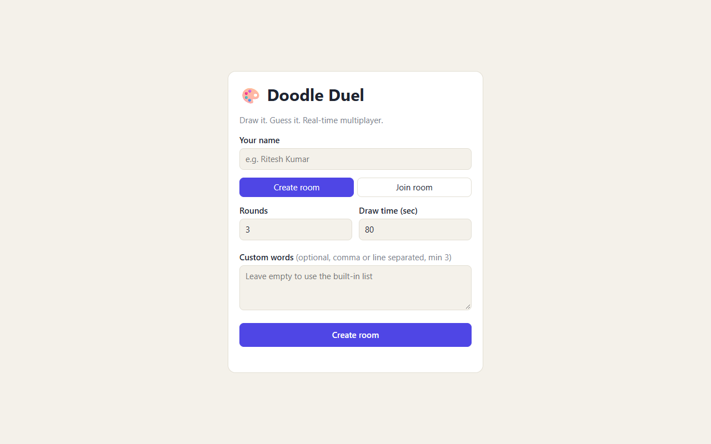 | 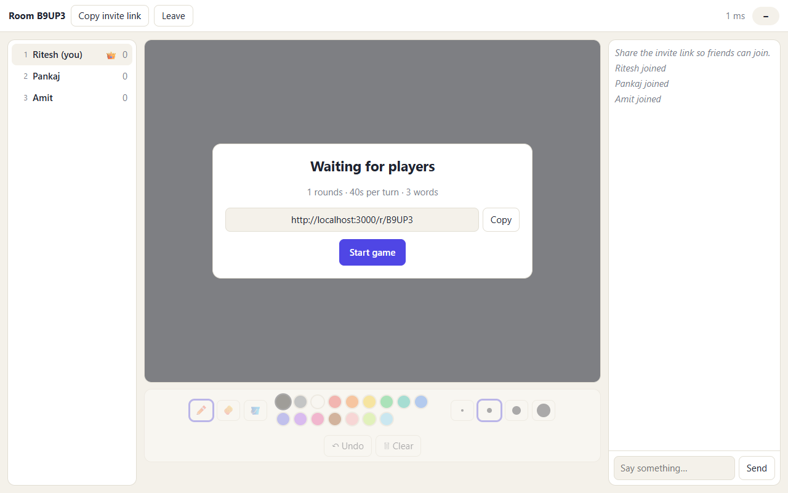 |
| 1. Home / create room | 2. Lobby with players |
| 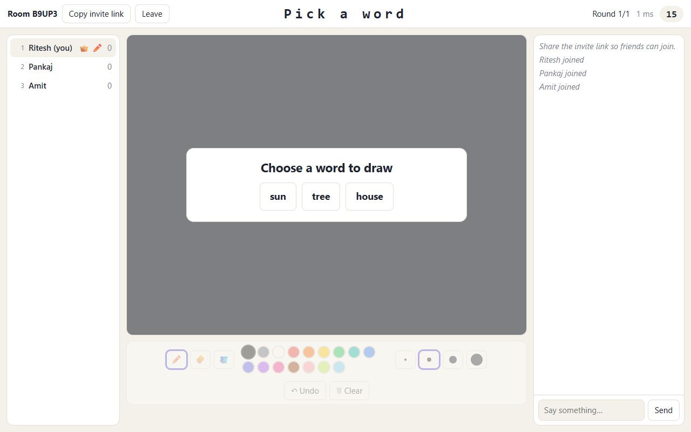 | 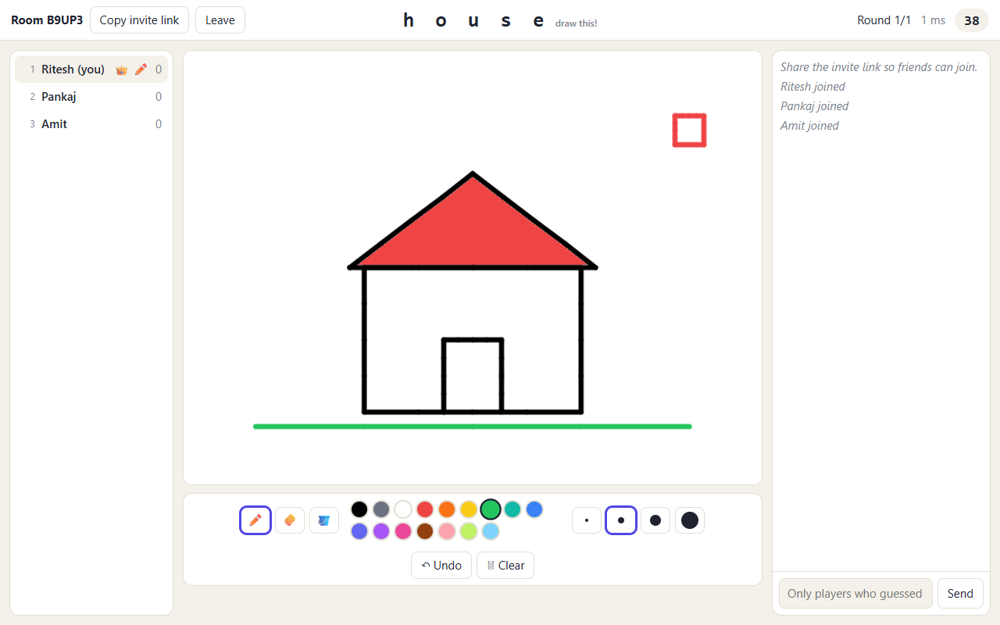 |
| 3. Drawer picks 1 of 3 words | 4. Drawer's canvas and tools |
| 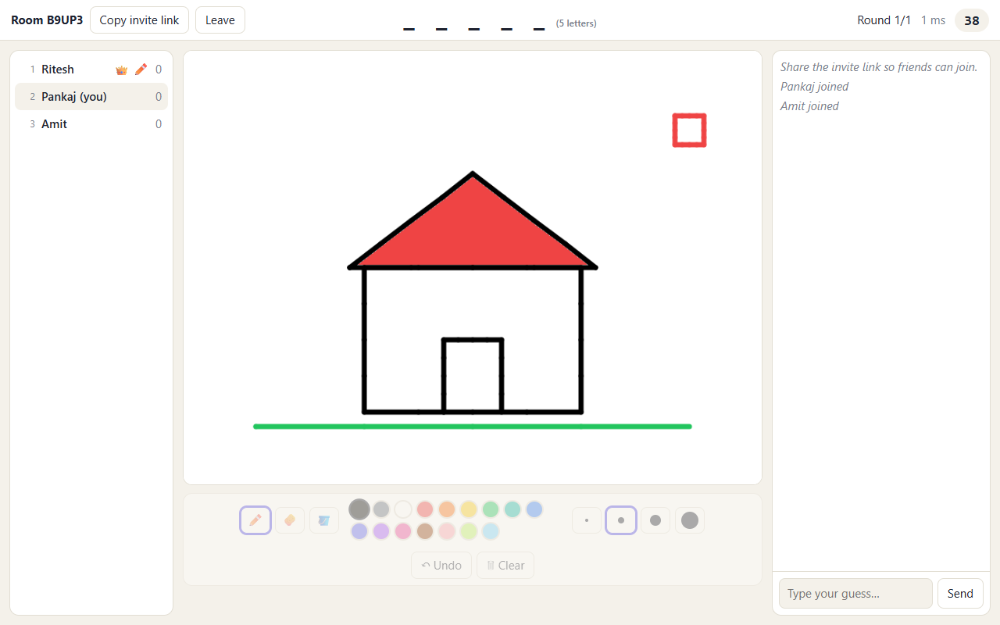 | 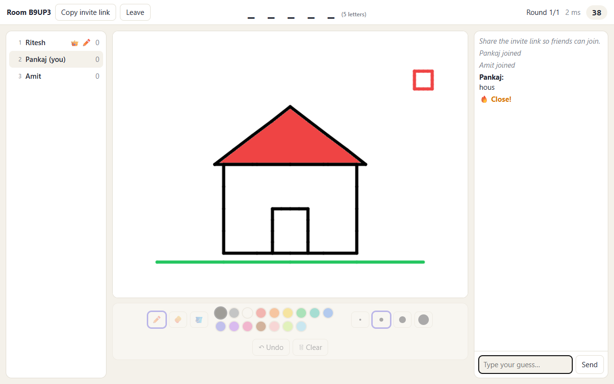 |
| 5. Guesser sees the live drawing and hint | 6. Near miss shows "Close!" to the guesser only |
| 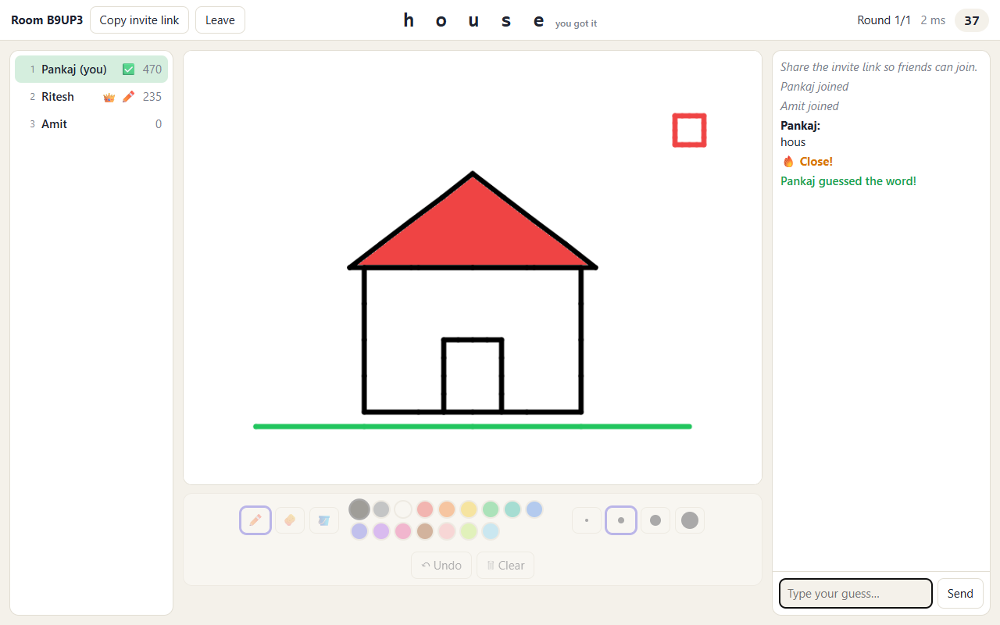 | 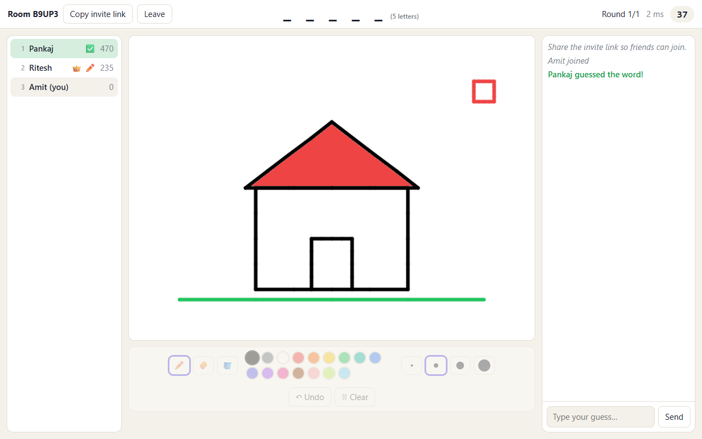 |
| 7. Correct guess awards points | 8. Other players still cannot see the word |
| 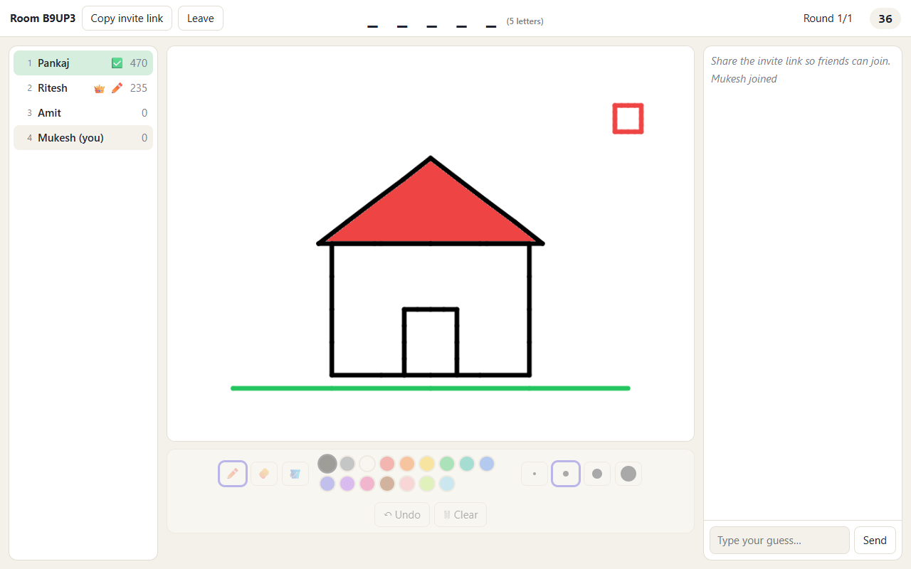 | 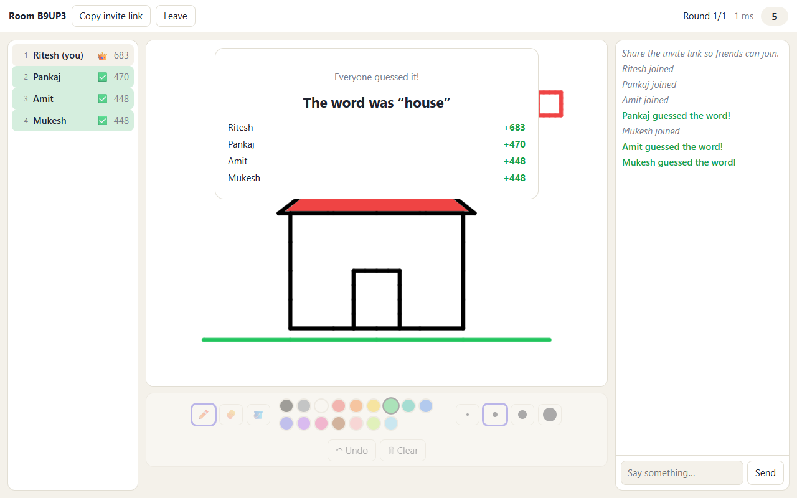 |
| 9. Player joining mid-round sees the canvas as it stands | 10. Turn end: word revealed, scores |
| 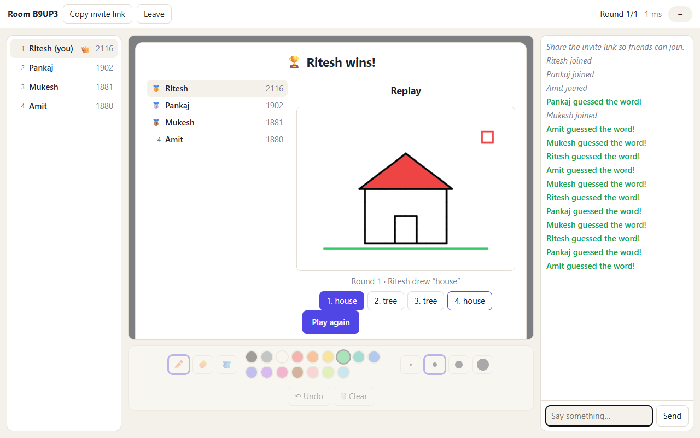 |  |
| 11. Game over and winner | 12. Stroke-by-stroke replay |

**Question 2: design** ([`images/q2-design/`](images/q2-design/)): architecture diagram, pause sequence diagram and pages of the design document.
