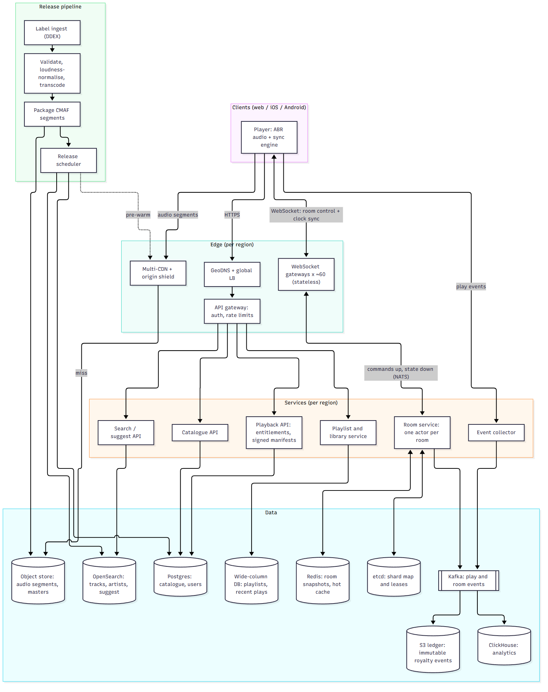
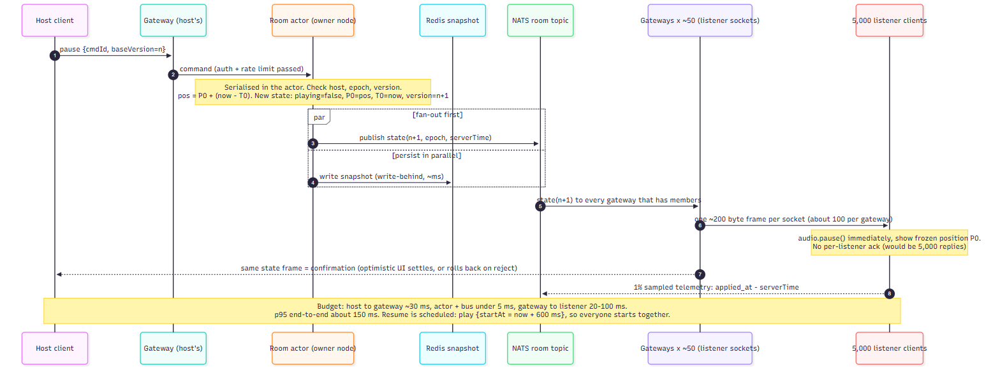

# Q2 — Music Streaming with "Listen Together" Rooms

## 0. Summary and sizing

**Core idea:** audio never goes through the room system. Every listener streams the *same segments from the CDN* as a normal listener. The room is only a tiny, authoritative **clock + state machine** (`track, position anchor, playing, queue, votes`). Every client derives "where should I be right now?" from that state and a shared server clock. This makes 5,000-listener rooms cost almost nothing beyond a normal stream, and it makes failover cheap, because **time is the state**: a running song needs no messages to keep going.

| Quantity | Estimate | Consequence |
|---|---|---|
| Audio egress at peak | 2M × ~160 kbps ≈ **320 Gbps** | CDN-only; origin sees ≤5 % |
| Track starts | 2M / 210 s ≈ **9.5 k/s** (≈30 k play events/s) | Kafka is trivial at this rate |
| Audio storage | 50M × ~11 MB (3-rung ladder) ≈ **0.6 PB** + ~1.2 PB lossless masters | Object store, multi-region |
| Catalogue metadata | 50M × ~2 KB ≈ **100 GB** | Fits a single Postgres primary + replicas |
| Room sockets | assume ≤25 % of listeners in rooms ⇒ **~500 k** (design for 1 M) | ~40–60 gateways at 25 k sockets each |
| Room control traffic | ~1 event / 10 s / room ⇒ ~20 k cmds/s in, ~50 k frames/s out | Small. Worst case one pause = 5,000 × ~200 B = 1 MB |

Only people *in a room* need a WebSocket; everyone else uses plain HTTPS.

## 1. Architecture

*Source: `architecture.mmd`. Three planes:* **data plane** (clients ⇄ CDN ⇄ object store), **control plane** (clients ⇄ gateways ⇄ room actors), **event plane** (Kafka → analytics and royalty ledger). Planes fail independently: if the control plane is down, music already playing keeps playing.

## 2. Key decisions and rejected alternatives

| # | Decision | Rejected alternative and why |
|---|---|---|
| 1 | **Sync the control plane, not the audio.** Clients pull from the CDN and align to a shared clock. | *Server mixes/streams one live audio stream per room* (internet-radio style): 200 k live encoders and stateful fan-out of ~100 Gbps, no ABR, no CDN cache sharing. |
| 2 | **Anchor model:** state = `(trackId, P0, T0, playing, version)`; position = `P0 + (serverNow − T0)`. Messages only on *change*. | *Broadcast position ticks every second*: 5,000 msgs/s per big room, jittery, and every missed tick is a bug. |
| 3 | **Split gateways (sockets, stateless) from room actors (state).** Fan-out is two-tier: actor → ~50 gateways → sockets. | *Sockets and state in one process:* simpler, but every deploy or crash drops sockets, and a hot room pins a node. |
| 4 | **One owner per room via lease + fencing epoch**; state snapshotted to Redis. | *Raft group per room:* 200 k consensus groups for a state that is tiny, low-write and recomputable. A 2–5 s command stall on failover is acceptable. |
| 5 | **NATS core pub/sub** for room fan-out (at-most-once, heal via `version`). | *Kafka for fan-out:* topic-per-room and latency don't fit. Kafka is used only for durable events. |
| 6 | **Playlists/history in a wide-column store; catalogue in Postgres.** | *One database for everything:* playlists (~10 B rows) and catalogue (100 GB, relational, read-mostly) have opposite shapes. |
| 7 | **OpenSearch for search**, ranked by text + popularity. | *Postgres FTS/trigram:* fine as the v1 shortcut (see §10), weak on typo-tolerance and popularity ranking at 50 M docs. |
| 8 | **Rooms pinned to a home region** (region in room code) with async-replicated snapshots to a standby region. | *Global multi-writer room state:* cross-region consensus latency on every pause/seek for a feature whose participants are usually co-located. |
| 9 | **Multi-CDN + origin shield, immutable content-addressed segment URLs.** | *Single CDN:* one vendor incident = global silence. |

## 3. Audio delivery

- **Ingest → encode:** label delivery (DDEX) → validate → loudness-normalise (−14 LUFS) → transcode a ladder of **HE-AAC 48 kbps, AAC 128, AAC 256** (lossless kept as master; Opus ladder postponed). Package as **CMAF fMP4 segments of 4 s** plus a small manifest. Encrypt segments (AES-128/CENC) with keys served by the Playback API.
- **Storage:** object store, cross-region replicated; URLs are immutable (`/t/{trackId}/{rung}/{n}.m4s`) ⇒ `Cache-Control: immutable`, no invalidation ever.
- **CDN:** two CDNs behind client-side failover (switch host after a 2 s stall), a tiered cache with **origin shield and request coalescing** so a cold track hit by 5,000 simultaneous listeners causes one origin read. Long-tailed popularity means the top ~1 M tracks serve nearly all traffic; expected hit ratio >95 %, i.e. ≤16 Gbps at origin.
- **Adaptive bitrate:** segment-level ABR driven by throughput estimate and buffer level (start with the rung last seen on this network; audio rungs are small enough that switching is cheap).
- **Fast start (target p95 time-to-first-audio < 400 ms):** the Playback API returns the **signed manifest and first-segment URL in one response** (no extra round trip); the first segment is requested at the cached rung; HTTP/3 + preconnect to the CDN host; the **next track's first segment is prefetched** in the last 30 s of the current one (gapless). For rooms, the actor sends a *prefetch hint* when the next track is known, and the pipeline pre-warms the CDN.

## 4. Catalogue and search

- **Metadata:** Postgres (artists, albums, tracks, rights, availability by market). Primary + read replicas, Redis/CDN cache in front of read APIs (stale-while-revalidate). 100 GB is small; no sharding needed in year one.
- **Search-as-you-type:** OpenSearch with (a) a *suggest index* of prefix n-grams for track/artist/album/playlist names weighted by popularity and (b) a full-text index for the results page. Client debounces ~80 ms and cancels stale requests; per-keystroke p99 < 100 ms; hot prefixes (1–3 chars) cached in Redis. Index lag from DB < 5 s via change-data-capture.
- **Publishing new releases:** pipeline = ingest → validate → transcode → package → store, all **before** the release time. The release scheduler flips `available_from` at the embargo timestamp (atomic per album), writes to Postgres, emits CDC to OpenSearch, and **pre-warms the CDN** for the scheduled drop (Friday-midnight spike). Nothing user-visible changes until the flip, so a failed transcode never leaves a half-released album.

## 5. Room sync (the hard part)

**State** (in the room actor, snapshotted to Redis): `{roomId, epoch, version, track, P0, T0, playing, queue[], next:{track, startsAt}, host, votes}`.

**Clock.** Client sends 5 pings on join, then every 30 s; keeps the **min-RTT sample** (`offset = serverTime − (t0 + rtt/2)`), so error ≈ RTT_min/2, typically <30 ms. Only monotonic time is used; the device's wall clock is irrelevant.

**Playing.** `target = P0 + (serverNow − T0)`. The client schedules playback against the audio clock and compensates reported output latency.
- *Drift loop (every 5 s):* |drift| < 40 ms → ignore; 40–200 ms → nudge `playbackRate` ±2 % until aligned (inaudible); > 200 ms → hard seek.
- **Pause is immediate; play and seek are scheduled.** Pause applies on receipt (skew = network jitter only, p95 ~100 ms). Resume/seek carry `startAt = now + 600 ms` so everyone starts on the same instant (late receivers jump ahead). This is how ~200 ms is met without waiting for acks.
- **Honest limit:** Bluetooth/AirPlay adds 100–300 ms the web can't always see. We use `outputLatency` where available and offer a one-tap manual calibration. The 200 ms SLO is for the control plane + decode path.

**Late joiners.** Join → gateway returns a snapshot `{state, serverTime}` → client does the 5-ping clock sync (~300 ms, in parallel with fetching the manifest) → starts at `target + expected startup latency`; if buffering overruns, re-evaluate target and skip forward rather than start late.

**Slow connections.** Sync is independent of bitrate: ABR drops to 48 kbps. After a stall, the client **jumps to live** instead of resuming where it paused. Control frames are tiny, versioned, and a **10 s heartbeat** carries `version`; a gap triggers a snapshot fetch, so missed frames self-heal. Chronically behind (>2 s for 30 s) → "You're behind" banner and lowest rung.

**Queue and skip votes.** All mutations are serialised in the actor (no conflicts). Add = one per user per 10 s, max 3 outstanding; host can lock the queue. Skip passes at ≥50 % of connected listeners (deduped per user). In big rooms, joins/leaves are **coalesced into a listener-count update every 2 s**, never fanned out individually (avoids O(n²)). Hard cap: 5,000 listeners; further joins get "room full".

**Failover.** Rooms map to 4,096 shards → nodes via etcd leases (3 s TTL). On owner death, another node takes the lease with **epoch+1**, loads the snapshot (Redis, plus last state seen by gateways, whichever has the higher `version`), and resumes. Clients/gateways reject any frame with a lower epoch (fences a stalled "zombie" owner). Because `state.next` already contains the following track and `startsAt`, **listeners keep playing and even advance to the next track during the outage**; only host commands stall for ~3–5 s.

*Source: `sequence-pause.mmd` — "host presses pause in a room of 5,000".*

## 6. Data and storage

| Data | Store | Why |
|---|---|---|
| Audio, masters | Object store (+ CDN) | Immutable blobs, cheap, replicated |
| Catalogue, users, entitlements | **Postgres** (replicas, cached) | Relational, small (100 GB), transactional release flips |
| Search / suggest | **OpenSearch** | Prefix, typo tolerance, popularity ranking |
| Playlists, library | **Wide-column (DynamoDB/Scylla)**, key `playlist_id`; order by fractional index + version | ~10 B rows, point reads, per-playlist optimistic concurrency |
| Recent plays (user-facing) | Wide-column, key `user_id`, time-ordered, TTL | Fast "recently played" without scanning analytics |
| **Room state** | In-memory actor + **Redis** snapshot (+ etcd for leases) | Tiny, hot, ephemeral; TTL 1 h after empty |
| Play/room events | **Kafka** (acks=all, RF=3) | Durable, replayable, decouples consumers |
| Analytics | **ClickHouse** | Columnar, fast aggregates over billions of events |
| **Royalties ledger** | Parquet in S3 (immutable, partitioned by day) + monthly aggregates in Postgres | Auditable; counted plays are never mutated |

**Royalty events:** client emits `play_start / heartbeat / play_end` with a server-issued `play_id` bound to a signed playback token; a play counts at ≥30 s. Pipeline is at-least-once with **idempotent dedupe on `play_id`**; a nightly job reconciles counted plays against CDN segment logs to catch gaps and fraud.

## 7. Reliability

- **Regional outage.** Stateless services, catalogue replicas, search replicas and CDN origins are multi-region. Room snapshots replicate async (~1 s lag) to a standby region. If a region dies, GeoDNS shifts traffic; standby takes ownership of the dead region's room shards (`epoch+1`) from the replicated snapshot. Listeners keep playing from their local anchor, reconnect with jittered backoff to the new region and resync; worst case we lose a few seconds of queue edits. Audio origin fails over to the replicated bucket.
- **Deploys without dropping rooms.** *Gateways:* rolling ≤5 % at a time; a draining node tells clients `reconnect in rand(0–10 s)` with a resume token. The socket is control-plane only, so **audio never stops**. *Room service:* graceful lease handoff, with old owner flushing its snapshot then releasing the lease, so command stall <1 s. Canary + automatic rollback on sync SLO breach.
- **When parts are struggling.** Per-user and per-room rate limits; circuit breakers + timeouts on every dependency; **load-shedding order** (first to go → last): presence counts and vote tallies UI → queue adds from non-hosts → joins to new rooms → *never* pause/seek/track-advance. Redis slow → actors run from memory and batch snapshots. Search slow → cached/prefix-only suggestions. Catalogue DB down → stale cache. Reconnect storms → gateway admission token bucket + jitter.

## 8. Failure scenarios

| # | Scenario | What happens |
|---|---|---|
| 1 | **Room owner node crashes mid-song** | Audio unaffected (clients hold anchor). Lease expires ≤3 s → new owner, `epoch+1`, state from Redis ∪ gateway cache; track advance continues from `state.next`. Host commands stall 3–5 s. |
| 2 | **Gateway dies / is drained during deploy** (up to ~25 k sockets) | Clients auto-reconnect with jitter to other gateways, send last `version`; receive a snapshot only if behind. Audio uninterrupted. Admission control prevents a thundering herd. |
| 3 | **Network partition: old owner still thinks it owns the room** (GC pause, split brain) | Its lease has expired; new owner holds a higher epoch. Gateways and clients drop frames with the old epoch; old owner's Redis writes are rejected by conditional-on-epoch writes. |
| 4 | **Redis (snapshots) down or slow** | Actors continue from memory, snapshotting best-effort; if an owner *also* dies, rooms recover from gateway-cached state (lose queue edits since). Alert; no user-visible stop. |
| 5 | **Whole region lost** | See §7: standby region adopts shards, CDN/origin fail over, clients reconnect and resync; seconds of queue edits lost, music continues. |
| 6 | **CDN degradation or cold-track stampede** (host queues an unpopular song for 5,000 people) | Request coalescing at shield → one origin fetch; actor pre-warms next track 30 s ahead; client-side CDN failover after 2 s stall; ABR drops rung. Worst case a few listeners rebuffer and **jump to live**. |
| 7 | **Listener on a terrible network / backgrounded phone / bad device clock** | Min-RTT clock sync (no dependence on the device clock); on resume, drift loop hard-seeks; chronic lag → lowest rung + banner. Never affects other listeners. |
| 8 | **Abuse: queue spam, skip-vote brigading, viral link flood** | Per-user quotas, host queue lock, votes deduped by authenticated user, hard 5,000 cap, join admission rate per room. |

## 9. Observability — "is sync actually working for users?"

The headline SLI: **% of listener-minutes with |position − expected| ≤ 200 ms** (SLO ≥ 99 %, p95 error ≤ 200 ms), computed from client telemetry (sampled 1 sample / 10 s per listener, always including the first 30 s after join).

1. `sync_error_ms` histogram (p50/p95/p99) by room-size bucket, region, platform, network type, output device (BT vs wired).
2. **Command propagation latency**: host action → listener applied (server-timestamped), p50/p99 per command type; delivery success rate.
3. **Time-to-sync** for late joiners and time-to-first-audio.
4. Drift-loop health: hard-seek rate per listener-hour, rate-nudge usage; clock-offset RTT_min distribution and offset jitter.
5. Self-healing signals: version-gap/resync rate, WS reconnect rate, rebuffer ratio, % of listeners "behind > 2 s".
6. Failover: lease handoff time, command-stall duration, rooms re-homed, epoch rejections.
7. **Synthetic canary rooms** in each region: headless listeners play a *watermarked test track* (a tick every second) and compare real decoded positions, so ground truth doesn't depend on real users' self-reports. Alerts page on canary p95 > 200 ms or SLI burn rate.
8. Audio golden signals: CDN hit ratio, origin egress, bitrate mix, startup time.

## 10. What I'd build first with a team of three — and what I'd postpone

**First (≈10 weeks; one region, boring tech):**
- **Dev A — audio + catalogue:** ingest → 3-rung AAC → CMAF → object store + one CDN; Postgres catalogue; search on **Postgres trigram first, OpenSearch later**; Playback API with signed manifests; basic playlists in Postgres.
- **Dev B — rooms:** one process combining gateway + actor (per-room in-memory state, Redis snapshot), the **anchor model**, queue/votes/pause/seek, scheduled resume, heartbeat+version healing.
- **Dev C — client + platform:** player with ABR, clock sync and drift loop (the make-or-break piece), **`sync_error_ms` telemetry and the synthetic canary from week 3**, CI/CD, dashboards, **play events into Kafka from day 1** (can't be backfilled).

**Postpone:** multi-region and standby regions, second CDN, gateway/actor split and lease-based sharding (single node handles tens of thousands of room listeners first), DRM beyond basic token auth, Opus/lossless, recommendations, offline mode, royalty-grade reconciliation (keep raw events, build later), collaborative-playlist conflict handling, and per-listener optimisations for rooms >1,000.
